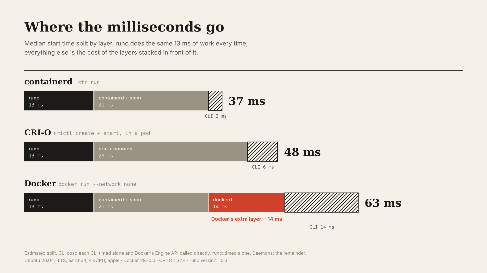

# runtime-bench

Benchmark **Docker vs containerd vs CRI-O** on the same Linux machine: how fast each one starts a container, how much memory it uses, and where the time goes.

All three end at the same low-level runtime (runc). This repo measures the cost of the layers in front of it, with one command to set up the machine and one to run the tests.

> Companion code for the article [Is Docker Really Slower? Benchmarking Docker vs containerd vs CRI-O](https://medium.com/@ayoubbahadda/is-docker-really-slower-benchmarking-docker-vs-containerd-vs-cri-o-f4b74e6c3e6a).

## Quick start

On a fresh **Ubuntu 26.04 / 26.10** VM (24.04 also works), set up with [Lima](docs/lima.md) (quickest on a Mac) or [UTM](docs/utm.md):

```bash
git clone https://github.com/yobahadda/bench_Crio_ContainerD.git
cd bench_Crio_ContainerD
make provision   # installs Docker, containerd, CRI-O, crictl and the benchmark image (Ansible)
make doctor      # checks everything is ready
make bench       # runs the suite, about 10 minutes
```

The results land in `results/<host>-<date>/`: raw JSON, a `summary.md`, and charts.



## What it measures

| Test | What | Command |
| --- | --- | --- |
| Start latency | Time from CLI call to a running container, for 7 variants (below) | `make latency` |
| Docker overhead | Docker's raw Engine API vs its CLI, plus each CLI's startup cost | part of `make bench` |
| Memory | PSS of each daemon idle, and with N containers running | `make memory` |
| Isolation | Does running all daemons side by side skew results? | `make bench-all` |

The latency variants:

| Key | Runtime | What it times |
| --- | --- | --- |
| `runc` | none | `runc run -d`, the floor |
| `ctr` | containerd | `ctr run -d` |
| `docker` | Docker | `docker run -d --network none` |
| `docker-bridge` | Docker | `docker run -d` with the default bridge network |
| `crio` | CRI-O | `crictl create` + `start` in an existing pod (what the kubelet does) |
| `crio-pod` | CRI-O | a new pod: sandbox + container |
| `crio-crun` | CRI-O | like `crio`, but with crun, CRI-O's own default runtime |

Every variant uses the same runc binary and the same 3 MB image, already local. Variants are interleaved in a new random order each round, and results are reported as median and p95. See [methodology](docs/methodology.md).

## Useful knobs

```bash
make bench ROUNDS=100            # more samples
make bench VARIANTS=ctr,docker   # just some variants
make quick                       # 2-minute smoke run
make report DIR=results/<run>    # re-render charts for a run
make image                       # rebuild the benchmark image
make help                        # everything else
```

Versions live in one place, [`ansible/group_vars/all.yml`](ansible/group_vars/all.yml) (for example `crio_version: "v1.37"`).

## Repo layout

```
ansible/          provisioning: roles common, docker, crio, bench
  group_vars/     all pinned versions and settings
bench/            the tests (Python standard library only)
image/            the benchmark image: static busybox + a tiny pause binary
report/           results -> charts (SVG/PNG) + summary.md
scripts/          bootstrap, doctor, run-all, isolation, collect-env
docs/             Lima and UTM setup, methodology
article/          the Medium article (HTML copy) and its images
results/          your runs (git-ignored)
```

## Provisioning from your host instead

If you prefer to run Ansible from your Mac or PC over SSH:

```bash
cp ansible/inventory/remote.example.ini ansible/inventory/remote.ini   # set the VM's IP and user
make provision-remote
```

Then clone the repo inside the VM to run the benchmarks.

## Sharing results

Results depend heavily on the machine. Please share yours, especially from ARM, cgroup v2, bare metal or bigger VMs: open an issue with your `summary.md` and `env.json`.

## License

MIT
